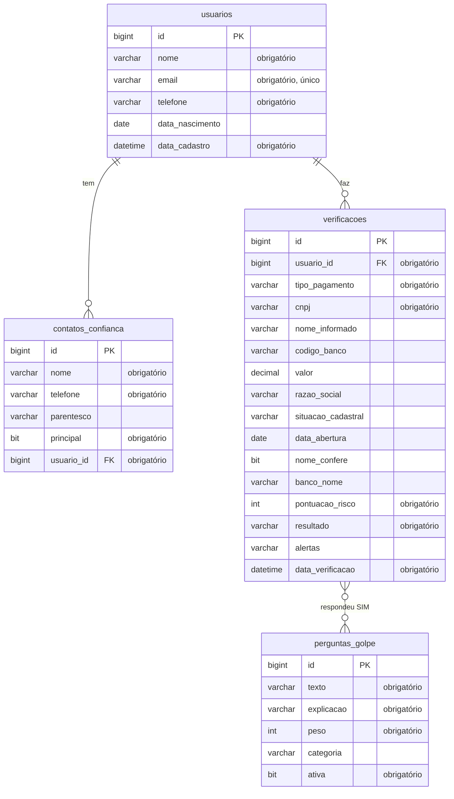

# ConfereAí API 🟢🟡🔴

**Global Solution 2026 — FIAP | Turma 3SIR**
Microservice and Web Engineering & IT Services

| Integrante | RM |
|---|---|
| Geisa Rodrigues Santos | 558820 |
| Matheus Soares Pereira | 558937 |

| Entrega | Link |
|---|---|
| API no Azure (Swagger) | https://app-confereai-api.braveplant-f1031e4f.chilecentral.azurecontainerapps.io |
| Docker Hub | https://hub.docker.com/r/thisgeh/confereai-api |
| GitHub Actions | Aba **Actions** deste repositório → workflow *Continuous Delivery* |

---

## 1. Objetivo da solução

A população idosa está cada vez mais conectada e virou o alvo preferido dos golpistas: 82% dos idosos do estado de São Paulo já sofreram tentativas de golpes virtuais (Fundação Seade, SP TIC 2025). Os golpistas se passam por bancos, lojas e parentes, usam a pressa e o medo e pedem pagamentos por boleto ou Pix.

O **ConfereAí** cria o hábito de **conferir antes de agir**. Esta API REST é o back-end do aplicativo e permite que, antes de pagar, o idoso:

1. **Confira quem está cobrando:** a API consulta o CNPJ na Receita Federal (via [BrasilAPI](https://brasilapi.com.br)) e informa se a empresa existe, se está ativa, há quanto tempo foi aberta e se o nome bate com o que foi dito.
2. **Confira o banco do boleto:** os 3 primeiros números da linha digitável são comparados com a lista oficial do Banco Central.
3. **Faça o teste do golpe:** perguntas simples de Sim/Não (pediram código? disseram que é urgente? parente com número novo?).
4. **Veja o resultado em um semáforo 🟢🟡🔴**, com a explicação de cada sinal de alerta em linguagem simples.
5. **Ligue para uma pessoa de confiança** com um toque: toda verificação devolve o contato principal com um link `tel:`.

---

## 2. Tecnologias

- Java 17 e Spring Boot 4 (Web MVC, Data JPA, Validation)
- Microsoft SQL Server (Azure SQL Database)
- ModelMapper (mapeamento Entity ↔ DTO)
- springdoc-openapi (Swagger UI)
- Docker, Docker Hub e GitHub Actions
- Azure Container Apps
- BrasilAPI (CNPJ e bancos)

---

## 3. Arquitetura

A aplicação segue arquitetura em camadas. As controllers só se comunicam com a camada Service; as regras de negócio ficam na Service; o acesso ao SQL Server fica na camada Repository.

```text
Controller ──> Service (regras de negócio) ──> Repository (JPA) ──> SQL Server
    │               │
  DTOs        BrasilApiService ──> BrasilAPI (Receita Federal / Banco Central)
(ModelMapper)
```

```text
src/main/java/br/com/fiap/confereai
├── controller   # uma controller por entidade + consultas rápidas
├── service      # regras de negócio, cálculo do semáforo, integração com a BrasilAPI
├── repository   # Spring Data JPA (SQL Server)
├── model        # entidades JPA
├── dto          # DTOs de request e response + mappers (ModelMapper)
├── exception    # exceções e tratamento global de erros
└── config       # OpenAPI, CORS, ModelMapper e carga inicial das perguntas
```

### 3.1 Modelo de dados

Quatro entidades, com tabelas nomeadas no plural:

| Tabela | Descrição | Relacionamentos |
|---|---|---|
| `usuarios` | Pessoa idosa que usa o app | 1:N com contatos e verificações |
| `contatos_confianca` | Pessoa para quem o idoso liga antes de pagar | N:1 com usuário |
| `perguntas_golpe` | Perguntas Sim/Não do teste do golpe, com peso de 1 a 5 | N:N com verificações |
| `verificacoes` | Conferência feita antes de um pagamento e seu resultado | N:1 com usuário; N:N com perguntas (`verificacoes_sinais`) |



As tabelas são criadas automaticamente pelo Hibernate. O script SQL equivalente está em [`src/main/resources/db/schema-sqlserver.sql`](src/main/resources/db/schema-sqlserver.sql). Na primeira execução, a aplicação cadastra as 7 perguntas padrão do teste do golpe.

### 3.2 Regras do semáforo

| Sinal de alerta | Pontos |
|---|---|
| CNPJ com dígitos verificadores inválidos (numérico ou alfanumérico) ou não encontrado na Receita | +5 |
| Empresa com situação diferente de ATIVA | +5 |
| Empresa aberta há menos de 6 meses / menos de 1 ano | +3 / +2 |
| Nome informado não confere com a razão social ou o nome fantasia | +3 |
| Código do banco fora da lista do Banco Central | +5 |
| Cada pergunta do teste respondida com SIM | + peso da pergunta |
| BrasilAPI indisponível no momento da consulta | +2 (CNPJ) / +1 (banco) |

**0 a 1 ponto: 🟢 VERDE · 2 a 4: 🟡 AMARELO · 5 ou mais: 🔴 VERMELHO**

---

## 4. Endpoints (v1)

A documentação interativa (Swagger/OpenAPI) é aberta na rota raiz `/`. A especificação em JSON está em `/v3/api-docs`.

| Recurso | Rota | Operações |
|---|---|---|
| Usuários | `/api/v1/usuarios` | POST, GET, GET /{id}, PUT /{id}, DELETE /{id} |
| Contatos de confiança | `/api/v1/contatos` (filtro `?usuarioId=`) | POST, GET, GET /{id}, PUT /{id}, DELETE /{id} |
| Perguntas do teste | `/api/v1/perguntas` (filtro `?somenteAtivas=true`) | POST, GET, GET /{id}, PUT /{id}, DELETE /{id} |
| Verificações | `/api/v1/verificacoes` (filtro `?usuarioId=`) | POST, GET, GET /{id}, PUT /{id}, DELETE /{id} |
| Consulta de CNPJ | `/api/v1/consultas/cnpj/{cnpj}` | GET |
| Consulta de banco | `/api/v1/consultas/bancos/{codigo}` | GET |

### Códigos HTTP

| Código | Situação |
|---|---|
| 201 Created | Recurso criado (POST) |
| 200 OK | Consulta ou atualização com conteúdo |
| 204 No Content | Exclusão |
| 400 Bad Request | Dados inválidos |
| 404 Not Found | Recurso inexistente |
| 409 Conflict | E-mail já cadastrado ou pergunta já usada em verificações |
| 503 Service Unavailable | BrasilAPI indisponível (consultas rápidas) |

Todos os erros seguem o mesmo formato, sem stack trace nem detalhes internos:

```json
{
  "timestamp": "2026-11-15T10:15:30",
  "status": 400,
  "erro": "Bad Request",
  "mensagem": "Dados inválidos. Verifique os campos informados.",
  "caminho": "/api/v1/usuarios",
  "campos": [ { "campo": "email", "mensagem": "E-mail inválido" } ]
}
```

---

## 5. Execução local

### 5.1 Pré-requisitos

- Java 17 ou superior
- Docker
- Maven (opcional: o projeto inclui o Maven Wrapper `mvnw`)

### 5.2 Variáveis de ambiente

As credenciais não ficam no código. A aplicação lê as configurações destas variáveis:

| Variável | Descrição | Exemplo |
|---|---|---|
| `DB_SERVER_URL` | Host do SQL Server | `localhost` |
| `DB_SERVER_PORT` | Porta | `1433` |
| `DB_SCHEMA` | Nome do banco | `confereai` |
| `DB_USER` | Usuário | `sa` |
| `DB_PWD` | Senha | — |
| `DB_ENCRYPT` | Conexão criptografada (perfil `prd`) | `true` no Azure, `false` local |
| `SPRING_PROFILES_ACTIVE` | Perfil do Spring | `dev` ou `prd` |

O arquivo [`.env.example`](.env.example) serve de modelo.

### 5.3 Opção A: SQL Server e API com Docker Compose

```sh
cp .env.example .env    # defina DB_PWD (mínimo 8 caracteres, com maiúscula, número e símbolo)
docker compose up --build
```

O Compose sobe o SQL Server, cria o banco `confereai` e inicia a API em http://localhost:8080.

### 5.4 Opção B: SQL Server em container e Spring Boot pelo Maven

Configuração do SQL Server:

```sh
docker run -d --name confereai-sqlserver -p 1433:1433 \
  -e ACCEPT_EULA=Y -e MSSQL_SA_PASSWORD='SuaSenha@2026' \
  mcr.microsoft.com/mssql/server:2022-latest

docker exec -it confereai-sqlserver /opt/mssql-tools18/bin/sqlcmd \
  -S localhost -U sa -P 'SuaSenha@2026' -C -Q "CREATE DATABASE confereai"
```

Execução do Spring Boot (Windows PowerShell):

```powershell
$env:DB_SERVER_URL="localhost"; $env:DB_SERVER_PORT="1433"; $env:DB_SCHEMA="confereai"
$env:DB_USER="sa"; $env:DB_PWD="SuaSenha@2026"; $env:SPRING_PROFILES_ACTIVE="dev"
.\mvnw.cmd spring-boot:run
```

Linux / macOS:

```sh
export DB_SERVER_URL=localhost DB_SERVER_PORT=1433 DB_SCHEMA=confereai DB_USER=sa
export DB_PWD='SuaSenha@2026' SPRING_PROFILES_ACTIVE=dev
./mvnw spring-boot:run
```

Testes automatizados: `./mvnw test`

---

## 6. Docker Hub

| | |
|---|---|
| Repositório | https://hub.docker.com/r/thisgeh/confereai-api |
| Imagem | `thisgeh/confereai-api` |
| Tags | `latest`, `v<número da execução>` (ex.: `v2`) e `<sha do commit>` (ex.: `a1b2c3d`) |

Para obter e executar a imagem:

```sh
docker pull thisgeh/confereai-api:latest

docker run -p 8080:8080 \
  -e DB_SERVER_URL=host.docker.internal -e DB_SERVER_PORT=1433 \
  -e DB_SCHEMA=confereai -e DB_USER=sa -e DB_PWD='SuaSenha@2026' \
  -e DB_ENCRYPT=false -e SPRING_PROFILES_ACTIVE=prd \
  thisgeh/confereai-api:latest
```

---

## 7. Continuous Delivery (GitHub Actions)

Workflow: [`.github/workflows/continuous_delivery.yml`](.github/workflows/continuous_delivery.yml)

A cada push na branch `main`, o workflow executa automaticamente:

1. checkout do código e configuração do Java 17;
2. build e testes da aplicação (`mvn clean verify`);
3. autenticação no Docker Hub (usuário na variable `DOCKER_USER` e token no secret `DOCKER_TOKEN`);
4. build da imagem Docker e publicação no Docker Hub com as tags `latest`, `v<run>` e `<sha>`.

O histórico das execuções está na aba **Actions** do repositório.

---

## 8. Implantação no Azure

| Recurso | Serviço |
|---|---|
| API | Azure Container Apps (imagem `thisgeh/confereai-api`) |
| Banco de dados | Azure SQL Database (`confereai`) |
| Credenciais do banco | Secret do Container App (não ficam no repositório) |

**URL da API:** https://app-confereai-api.braveplant-f1031e4f.chilecentral.azurecontainerapps.io

Os comandos de provisionamento (Azure CLI) estão documentados em [DEPLOY_AZURE.md](DEPLOY_AZURE.md).

---

## 9. Como testar

Os testes podem ser feitos pelo Swagger, na raiz da URL da API, ou pelo arquivo [`requests.http`](requests.http) (extensão REST Client do VS Code). Roteiro sugerido:

| # | Requisição | Resultado esperado |
|---|---|---|
| 1 | `GET /api/v1/perguntas?somenteAtivas=true` | 200, com as 7 perguntas do teste |
| 2 | `POST /api/v1/usuarios` (corpo abaixo) | 201 |
| 3 | `POST /api/v1/contatos` (corpo abaixo) | 201, contato marcado como principal |
| 4 | `POST /api/v1/verificacoes`, verificação legítima | 201, resultado **VERDE** |
| 5 | `POST /api/v1/verificacoes`, verificação suspeita | 201, resultado **VERMELHO** |
| 6 | `GET /api/v1/verificacoes?usuarioId=1` | 200, histórico salvo no SQL Server |
| 7 | `PUT /api/v1/usuarios/1` | 200 |
| 8 | `GET /api/v1/usuarios/9999` | 404 |
| 9 | `POST /api/v1/usuarios` com e-mail inválido | 400 |
| 10 | `DELETE /api/v1/verificacoes/1` | 204 |

**2. Usuário**
```json
{ "nome": "Maria Aparecida da Silva", "email": "maria.silva@email.com", "telefone": "11987654321", "dataNascimento": "1952-03-15" }
```

**3. Contato de confiança**
```json
{ "nome": "Carlos", "telefone": "11912345678", "parentesco": "Filho", "principal": true, "usuarioId": 1 }
```

**4. Verificação legítima** (CNPJ real do Banco do Brasil, nome confere, banco 001, nenhuma resposta SIM)
```json
{ "usuarioId": 1, "tipoPagamento": "BOLETO", "cnpj": "00.000.000/0001-91", "nomeInformado": "Banco do Brasil", "linhaDigitavel": "00190000090123456789012345678901123450000010000", "valor": 150.00, "respostasSim": [] }
```

**5. Verificação suspeita** (nome não confere, banco 999 inexistente, pediram código e disseram que é urgente)
```json
{ "usuarioId": 1, "tipoPagamento": "PIX", "cnpj": "00000000000191", "nomeInformado": "Casas Bahia", "codigoBanco": "999", "respostasSim": [1, 2] }
```

### Comprovação da persistência

Os dados podem ser consultados diretamente no SQL Server (Azure Portal → SQL Database → Query editor):

```sql
SELECT * FROM usuarios;
SELECT id, cnpj, resultado, pontuacao_risco, data_verificacao FROM verificacoes;
```

---

## 10. Segurança

- Nenhuma credencial é versionada: as senhas e os tokens ficam em variáveis de ambiente, nos GitHub Secrets e nos secrets do Container App.
- As respostas de erro são padronizadas e não expõem stack traces nem detalhes internos.
- O container é executado com um usuário sem privilégios de root.